# Cómo usar Taipea

[Read in English](USAGE.md) · [Volver al README](../README.es.md)

Esta guía muestra cada parte de Taipea con capturas de pantalla. Taipea sigue el idioma de
tu Mac (o el que elijas en Ajustes), así que en español verás estas mismas pantallas.

- [1. Primer inicio y permisos](#1-primer-inicio-y-permisos)
- [2. Dictar: el botón flotante](#2-dictar-el-botón-flotante)
- [3. La tarjeta de grabación](#3-la-tarjeta-de-grabación)
- [4. Atajos](#4-atajos) · [Cambiar un atajo](#cambiar-un-atajo) · [Tecla Micrófono (Dictado)](#tecla-microfono)
- [5. La pestaña Historial](#5-la-pestaña-historial)
- [6. Ajustes](#6-ajustes)
- [7. La pestaña Modelos](#7-la-pestaña-modelos)
- [8. Actualizaciones](#8-actualizaciones)
- [9. ¿Problemas?](#9-problemas)

## 1. Primer inicio y permisos

Cuando el instalador termina, reinicia Hammerspoon. Taipea muestra entonces un ícono 🎙 en
la barra de menús y un botón redondo de micrófono flotando en la pantalla. Para abrir la
ventana de Taipea, presiona **Control + Opción + H**, abre **Taipea.app** desde
`~/Applications` (puedes ponerla en el Dock) o elige **Abrir Taipea…** en el menú 🎙.

macOS pide dos permisos una sola vez. Taipea corre dentro de Hammerspoon, así que los dos
son para **Hammerspoon**:

1. **Accesibilidad**, para que Taipea pueda pegar donde está tu cursor. El instalador
   ofrece abrir esa página por ti. Ve a Ajustes del Sistema › Privacidad y seguridad ›
   Accesibilidad y activa **Hammerspoon**. En macOS 27 esa lista se llama **Control de
   dispositivos y acceso a datos** (el ítem Accesibilidad de la barra lateral es VoiceOver,
   no este permiso).
2. **Micrófono**. macOS pregunta la primera vez que dictas. Haz clic en **Permitir**.

Si Accesibilidad está apagada, la ventana de Taipea muestra un aviso rojo con un botón
grande **Abrir ajustes de Accesibilidad**. Tu texto no se pierde: queda en el portapapeles
(presiona Cmd + V) y en el Historial. Si una grabación sale vacía, un aviso naranja te
lleva a los ajustes de Micrófono. Ajustes › Permisos tiene los dos botones siempre.
Ajustes › Micrófono elige con qué entrada graba Taipea, sin cambiar la del Mac.

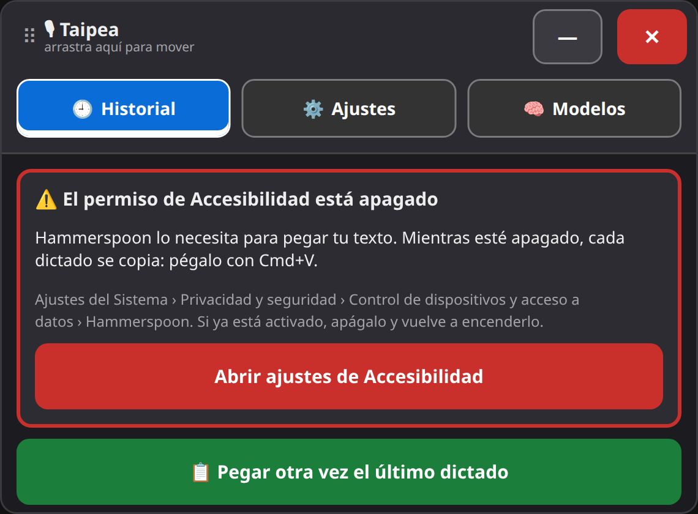

## 2. Dictar: el botón flotante

El botón flotante es la forma más fácil de dictar con un mouse, un mouse de cabeza o un
pulsador. Queda encima de las otras ventanas. Arrástralo a donde quieras y recuerda dónde
lo dejaste.

| En reposo (Azul clásico) | En reposo (Estudio) | Grabando |
|---|---|---|
|  |  | 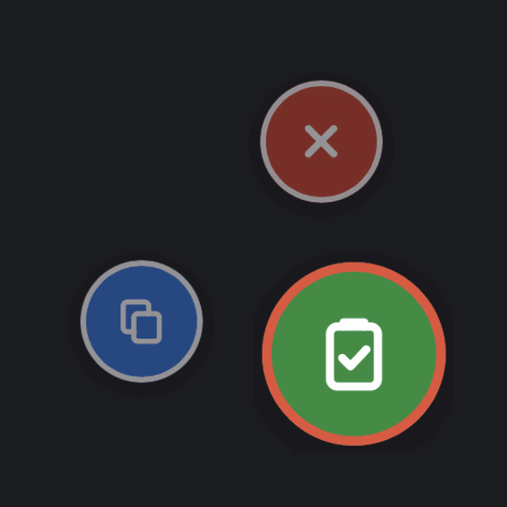 |

- **En reposo:** haz clic para empezar a dictar. El círculo es vidrio esmerilado, así que
  se ve el escritorio; la marca T con serifa y el anillo de acento se quedan sólidos.
- **Tamaño:** presiona el anillo exterior y arrastra hacia fuera o hacia dentro (64–220 px).
  Una etiqueta muestra el tamaño mientras arrastras; un clic que no se mueve sigue siendo
  un clic. Ajustes › Botón flotante tiene Más pequeño / Más grande, tamaños fijos y Tamaño
  predeterminado.

- **Grabando:** se pone **verde**. Haz clic para parar: Taipea transcribe, corrige y pega
  en la app que estabas usando. Aparecen dos botones más pequeños al lado: **azul = Parar
  y solo copiar** (el texto va al portapapeles y al Historial, no se pega nada) y **rojo =
  Cancelar**. Crecen y muestran su nombre cuando el puntero está encima.
- **Trabajando:** después de parar, muestra que Taipea está transcribiendo y corrigiendo.
- **Escuchando:** con empezar / parar con la voz activado, tiene un anillo verde mientras
  espera tu frase de inicio.

Los colores nunca cambian de significado: verde = parar y pegar, azul = parar y solo
copiar, rojo = cancelar. Presiona **Opción + Comando** para ocultar el botón, y otra vez
para mostrarlo (mira [Ocultar el botón flotante](#controles-de-grabación-y-ocultar-el-botón-flotante)).

## 3. La tarjeta de grabación

Si apagas el botón flotante, o activas **Mostrar también la tarjeta de grabación**, mientras
dictas aparece una tarjeta con tres botones grandes: **Parar y pegar**, **Parar y solo
copiar** y **Cancelar**. Muestra un contador y cómo terminar. Arrástrala a donde quieras.
(Las capturas de la tarjeta y del botón flotante están en inglés; en tu Mac salen en tu
idioma.)

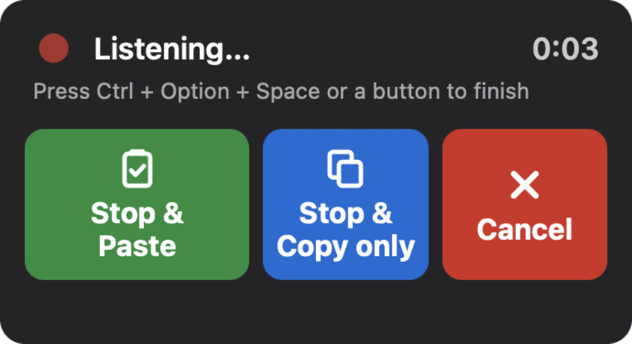

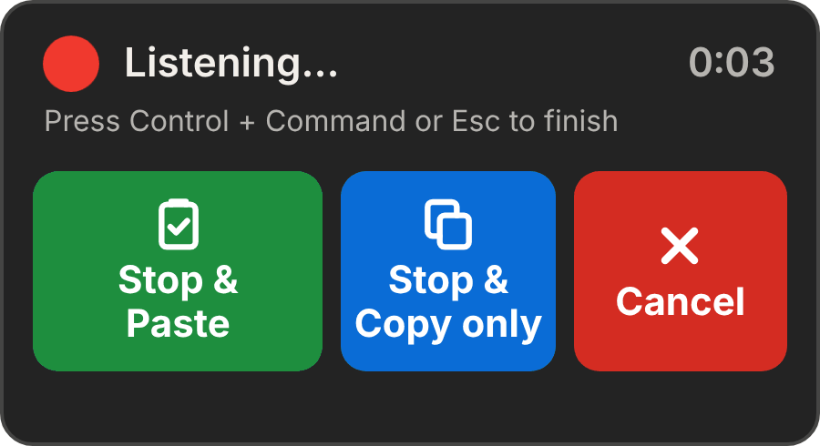

## 4. Atajos

| Atajo | Qué hace |
|---|---|
| **Control + Comando** | Empieza a dictar. Presiónalo otra vez para parar y pegar en tu cursor. Presiona las dos teclas juntas (en el Teclado de accesibilidad, haz clic en Control y luego en Comando para que las dos queden fijas). Actúa apenas las dos están abajo, no cuando las sueltas. |
| **Control + Opción + Espacio** | El mismo empezar / parar, como respaldo. |
| **Escape** (mientras grabas) | Para y pega. Solo Escape sola, y solo mientras Taipea graba; el resto del tiempo Escape funciona como siempre. Para descartar una grabación, usa **Cancelar**. |
| **Control + Opción + C** | Activa o desactiva la corrección. Desactivada = texto original, tal como lo oyó Whisper. |
| **Control + Opción + H** | Abre la ventana de Taipea (Historial, Ajustes, Modelos). |
| **Control + Opción + V** | Pega otra vez el último dictado. |
| **Opción + Comando** | Oculta o muestra el botón flotante. Presiona las dos teclas juntas. |
| **🎙 Tecla Micrófono (F5)** | Opcional, apagada por defecto: empezar / parar. Mira [Usar la tecla Micrófono (Dictado)](#tecla-microfono). |

Control + Comando y Opción + Comando esperan un momento (como un cuarto de segundo) antes de
actuar. Si presionas otra tecla en ese momento (por ejemplo Control + Comando + Q para
bloquear la pantalla), Taipea no hace nada, así que los demás atajos siguen funcionando.
Mantener las teclas presionadas cuenta una sola vez.

### Cambiar un atajo

Todos los atajos se pueden cambiar en **Ajustes › Atajos**. No necesitas escribir nada:

1. Haz clic en **⏺ Grabar atajo** en la fila que quieres cambiar.
2. La fila dice **Presiona tus teclas ahora… (Esc para cancelar)**. Presiona el atajo nuevo:
   teclas modificadoras con una tecla (como Control + Opción + Espacio), o dos o más teclas
   modificadoras solas (como Control + Mayúsculas + Comando). En el Teclado de accesibilidad,
   haz clic en las teclas modificadoras para que queden fijas; Taipea las toma después de un
   momento.
3. Revisa las teclas que muestra y haz clic en **Guardar**. **Grabar otra vez** lo intenta de
   nuevo y **Cancelar** deja el anterior.

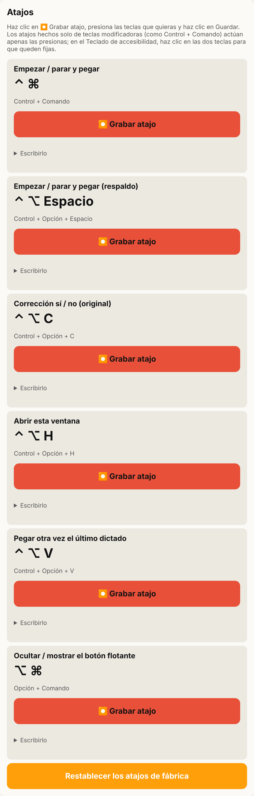

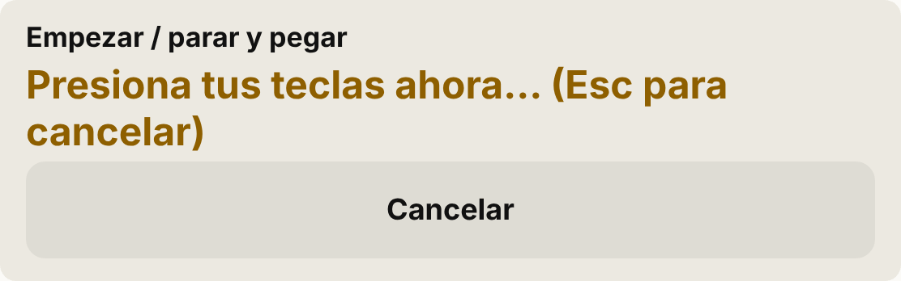

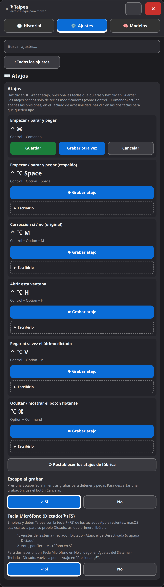

Taipea rechaza un atajo, y dice por qué, cuando es una sola tecla o Mayúsculas + una tecla
(también escribiría; F1–F20 solas sí sirven), una sola tecla modificadora, un atajo que macOS
ya usa (como Comando + Q, Comando + Espacio o Control + Comando + Q), uno que ya tiene otro
atajo de Taipea, o la tecla Micrófono (tiene su propio interruptor). No aparece el botón
Guardar hasta que grabes uno que sirva.

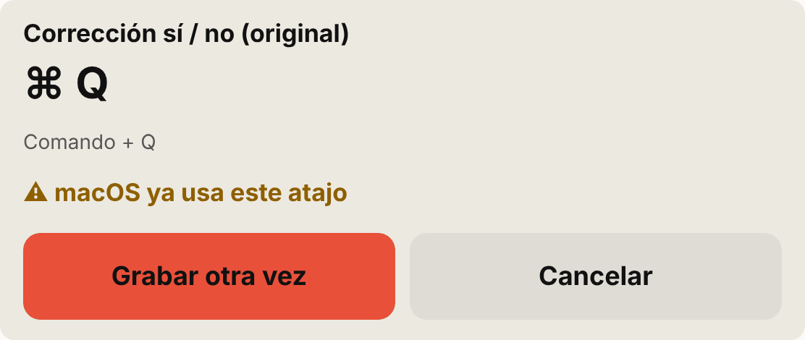

¿Prefieres escribirlo? Abre **Escribirlo** debajo de una fila, escríbelo como `ctrl+cmd` o
`ctrl+alt+space` (teclas: `ctrl`, `alt` = Opción, `shift`, `cmd`, más una tecla opcional) y
presiona **Guardar**. **Restablecer los atajos de fábrica** los devuelve todos.

**Consejo: un botón de Taipea en el Teclado de accesibilidad.** Puedes agregar tu propio
botón que empiece y pare Taipea. Abre el **Editor de paneles** (Ajustes del Sistema ›
Accesibilidad › Teclado › Teclado de accesibilidad › Editor de paneles), haz una copia del
panel de tu teclado, agrega un botón, pon su **Acción** en **Presionar teclas**, haz clic en
**Grabar** y presiona **Control + Opción + Espacio** (el atajo de respaldo). Guarda y elige ese
panel en el Teclado de accesibilidad. Un clic empieza el dictado y otro lo para y pega.

### Escape al grabar

**Ajustes › Atajos › Escape al grabar** está en **Sí** por defecto: Escape para y pega.
Ponlo en **No** si usas Escape para otra cosa mientras dictas.

### Usar la tecla Micrófono (Dictado) 🎙 (F5)

Los teclados Apple recientes tienen una tecla 🎙 en F5. macOS la usa para su propio
Dictado, así que solo le llega a Taipea después de liberarla. En Taipea está apagada por
defecto.

1. Abre **Ajustes del Sistema › Teclado**. En la sección **Dictado**, pon **Atajo** en
   **Desactivada** (o elige otro atajo). También puedes apagar Dictado ahí.
2. En Taipea, abre **Ajustes › Atajos** y pon **Tecla Micrófono (Dictado) 🎙 (F5)** en **Sí**.
3. Presiona 🎙 para empezar, y otra vez para parar y pegar.

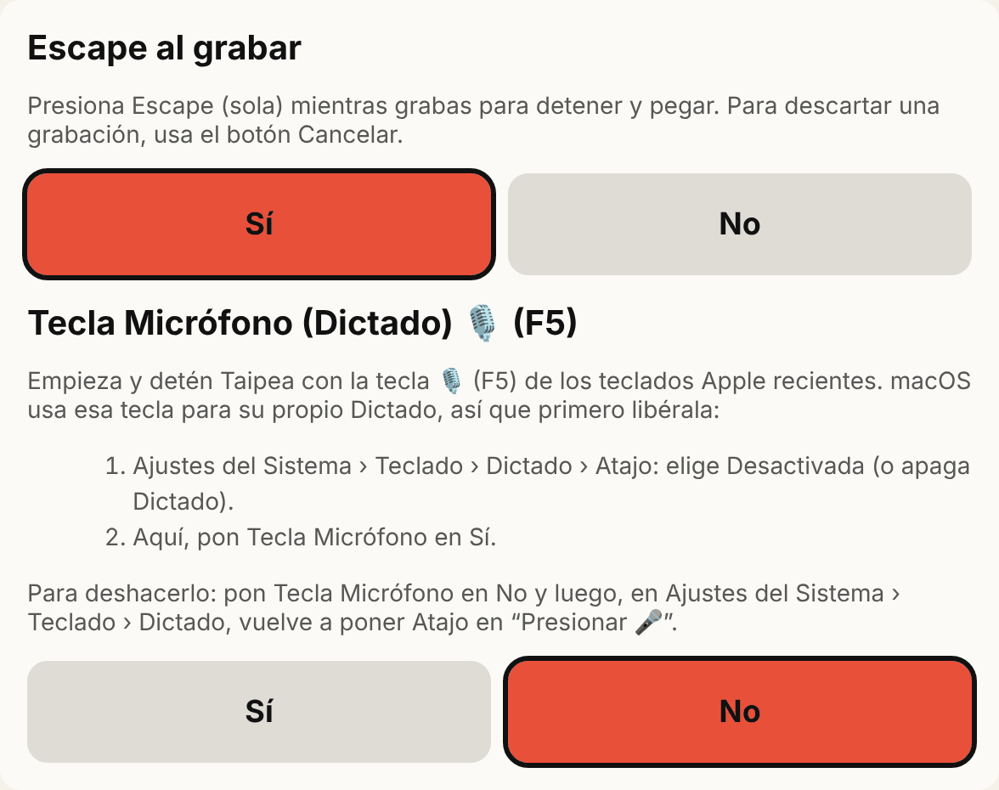

Para deshacerlo: pon **Tecla Micrófono (Dictado)** en **No** en Taipea y luego, en Ajustes
del Sistema › Teclado › Dictado, vuelve a poner **Atajo** en **Presionar 🎤** (y vuelve a
activar Dictado si lo apagaste).

## 5. La pestaña Historial

Cada dictado se guarda en tu Mac (`~/Library/Application Support/Taipea/history.json`).

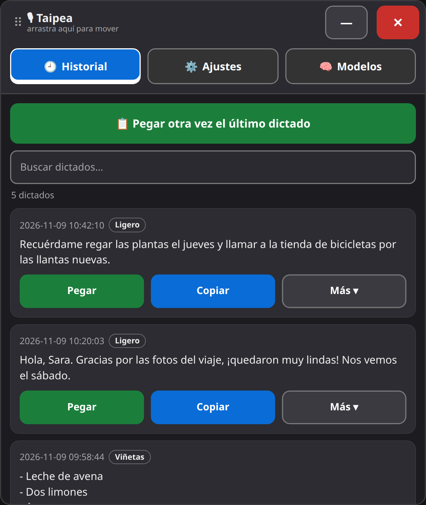

- **📋 Pegar otra vez el último dictado** arriba (también Control + Opción + V).
- **Buscar** encuentra palabras en el texto corregido o en el original.
- Cada tarjeta tiene tres botones grandes: **Pegar** (en la app que estabas usando),
  **Copiar** y **Más ▾**. Más muestra el texto original, copiar original, convertir a otro
  estilo y Borrar.
- **Borrar** pide confirmación. **Conservarlo** aparece justo donde estaba Borrar, así un
  doble clic o un temblor conserva el dictado.
- **Convertir a:** convierte tus palabras originales en texto **Ligero**, **Párrafos**,
  **Viñetas** o **Formal** con un clic. Las palabras originales siempre se conservan.
- Los textos largos se pliegan con **Ver todo** / **Ver menos**.
- **Borrar todo** borra todo el historial. Pide confirmación, con **Conservarlo** en el
  mismo sitio.

## 6. Ajustes

Los ajustes se guardan al momento, sin botón de guardar (salvo en los cuadros de texto).
La pestaña abre en una cuadrícula de mosaicos grandes (8 grupos). Cada mosaico muestra un
resumen de una línea. El buscador encuentra cualquier ajuste por nombre o palabra clave.
**‹ Todos los ajustes** vuelve a los mosaicos.

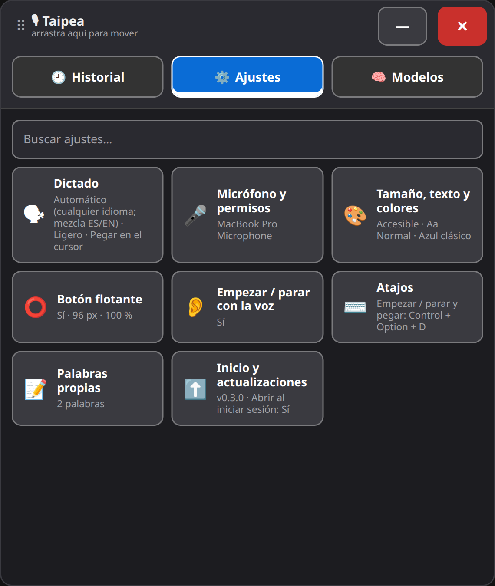

### Idioma, diseño, colores, tamaño del texto y contraste

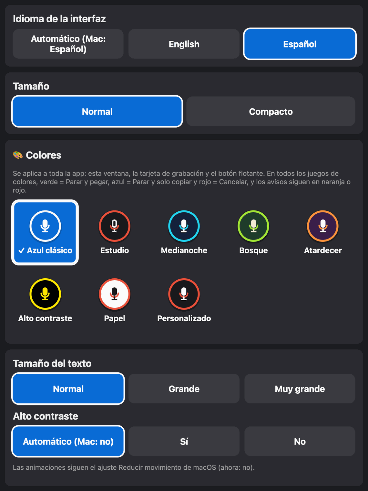

- **Idioma de la interfaz:** Automático (sigue a tu Mac), English o Español.
- **Diseño:** Accesible (predeterminado: altura completa, objetivos de 60 px) o Estándar
  (una ventana normal de 640 × 680 que cabe en un MacBook de 13 pulgadas). Los valores
  guardados siguen siendo `normal` / `compact`.

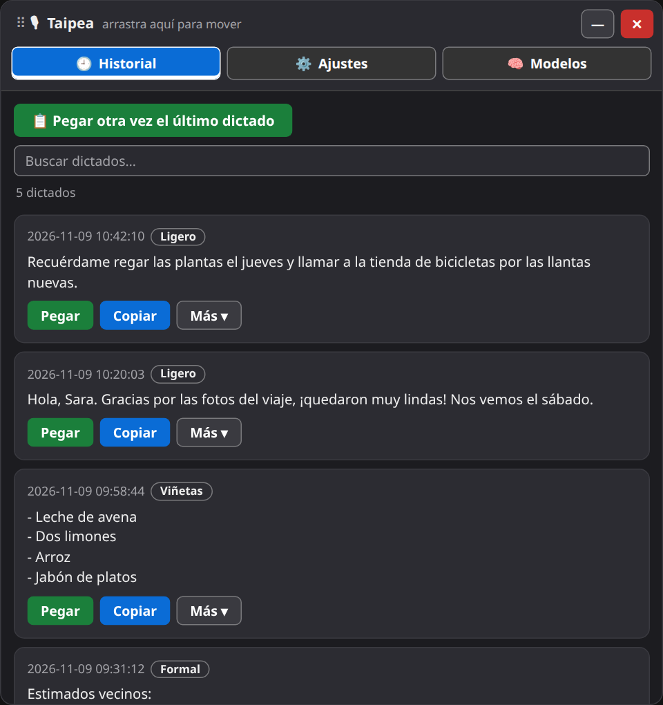
- **Colores:** 8 juegos para toda la app (ventana, tarjeta de grabación y botón flotante):
  Azul clásico, Estudio, Medianoche, Bosque, Atardecer, Alto contraste, Papel y
  Personalizado (eliges el fondo, el micrófono y el color de acento). El texto que sería
  difícil de leer se ajusta solo.
- **Tamaño del texto:** Normal, Grande o Muy grande. Escala los dos diseños y la tarjeta
  de grabación.
- **Alto contraste:** Automático (sigue Aumentar contraste de macOS), Sí o No. Las
  animaciones siguen el ajuste Reducir movimiento de macOS. Reducir transparencia de
  macOS deja el botón flotante sólido, sin desenfoque (no hay un ajuste extra en Taipea).

### Parar con el silencio y empezar / parar con la voz

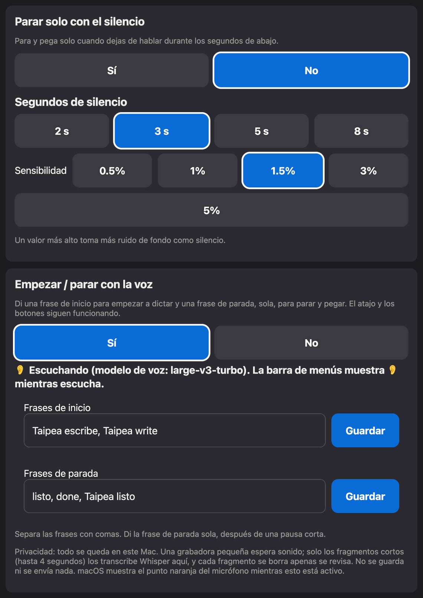

- **Parar solo con el silencio:** con Sí, Taipea para y pega solo cuando dejas de hablar
  durante 2, 3, 5 u 8 segundos. **Sensibilidad:** un valor más alto toma más ruido de
  fondo como silencio.
- **Empezar / parar con la voz** (apagado por defecto): di **"Taipea escribe"** o
  **"Taipea write"** para empezar, y **"listo"**, **"done"** o **"Taipea listo"** solo,
  para parar y pegar. Las frases se pueden editar (sepáralas con comas). Corre solo en tu
  Mac. Mientras escucha, la barra de menús muestra 👂. Lee
  [Empezar / parar con la voz](../README.es.md#empezar--parar-con-la-voz) para saber cómo
  funciona y sus límites.

### Controles de grabación y ocultar el botón flotante

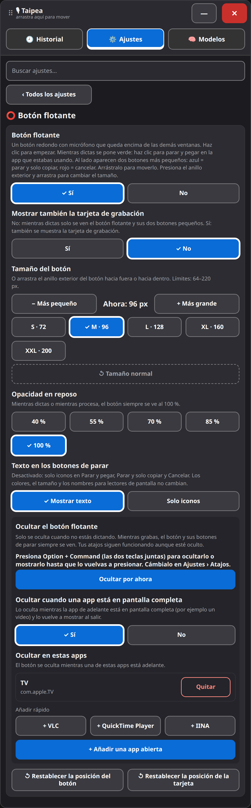

- **Botón flotante:** Sí o No. **Mostrar también la tarjeta de grabación:** muestra
  también la tarjeta grande mientras dictas.
- **Tamaño del botón:** Más pequeño / Más grande, tamaños fijos (S 72, M 96, L 128, XL 160,
  XXL 200) o Tamaño predeterminado. O arrastra el anillo exterior. Límites: 64–220 px.
- **Opacidad en reposo:** 40–100 %. Mientras dictas o trabaja, se ve al 100 %.
- **Texto en los botones de parar:** Mostrar texto, o Solo íconos (los nombres de VoiceOver
  no cambian).
- **Ocultar el botón flotante:** presiona **Opción + Comando** u **Ocultar por ahora**.
  Vuelve cuando lo presionas otra vez. Puedes cambiar el atajo en Ajustes › Atajos.
- **Ocultar cuando una app está en pantalla completa** (activado por defecto) y
  **Ocultar en estas apps** (botones rápidos para TV, VLC, QuickTime Player e IINA, o
  **Añadir una app abierta**).
- Nunca se oculta mientras grabas o mientras Taipea trabaja, así que Parar siempre está a
  mano.
- **Restablecer la posición del botón** y **Restablecer la posición de la tarjeta** los
  traen de vuelta a la pantalla.

### Otros ajustes

- **Palabras propias:** por ejemplo, escribir "selektdev" cuando Whisper oye "select dev".
- **Corrección (gramática):** Sí, o No (original). **Estilo:** Ligero, Párrafos, Viñetas o
  Formal.
- **Idioma del dictado:** Automático, English o Español. Automático también reconoce unos
  99 idiomas más ([Otros idiomas](../README.es.md#otros-idiomas)).
- **Quitar alucinaciones de Whisper (etiquetas de sonido, bucles repetidos):** activado de
  fábrica. Después de Whisper y antes de la corrección, Taipea quita etiquetas inventadas
  como `[Music]` o `(applause)`, y descarta el texto que es solo etiquetas o una frase
  repetida en bucle. Tus palabras reales, incluidos corchetes y repeticiones cortas como
  «el el», se conservan.
- **Silenciar otros sonidos mientras dictas:** No por defecto. Silencia la salida del Mac
  para que otras apps se callen mientras hablas. El sonido de empezar suena antes; el de
  parar suena cuando vuelve el sonido. Busca en Ajustes mute, silenciar, youtube o volume.
- **Transcripción en vivo** (sin interruptor en Ajustes) corta en las pausas naturales
  para que Parar sea casi instantáneo. Claves avanzadas en `config.lua`: `liveChunking`
  (`"adaptive"` por defecto, `"fixed"` para las ventanas antiguas de 24 s),
  `liveChunkTarget`, `liveChunkMax`, `liveChunkMin`, `livePause`, `liveChunkOverlap`.
- **Al parar:** Pegar en el cursor, o Solo copiar.
- **Abrir al iniciar sesión** y **Mostrar la ventana al iniciar sesión**.

## 7. La pestaña Modelos

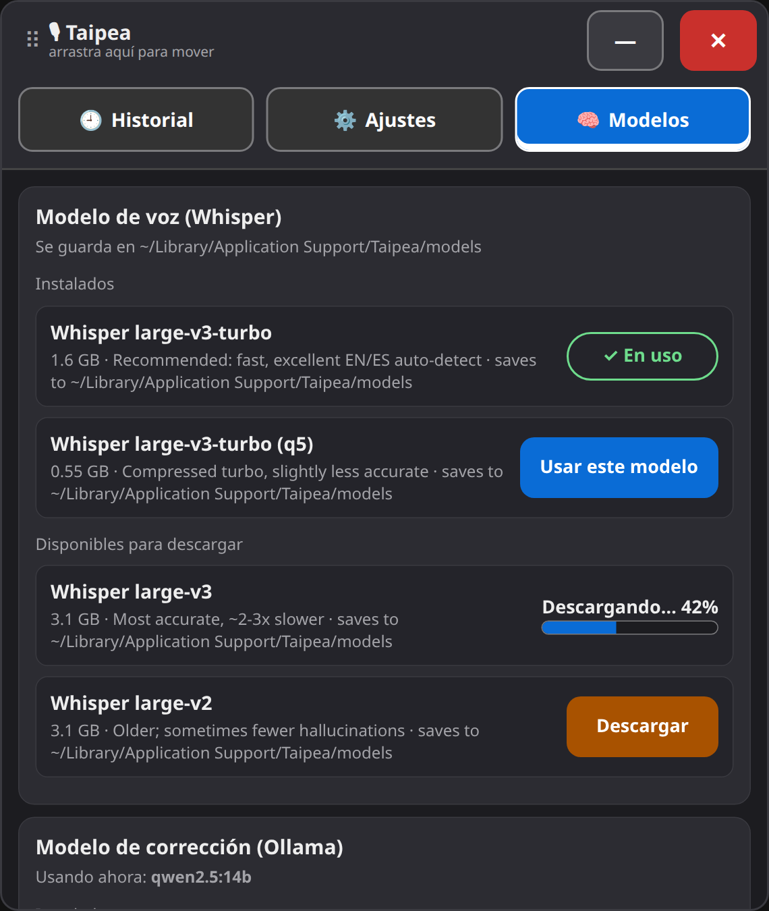

- **Modelo de voz (Whisper)** convierte tu voz en texto. El instalador descarga
  large-v3-turbo (o el turbo q5, más pequeño, si lo elegiste). Presiona **Descargar** para
  bajar otro y **Usar** para cambiar. El que usas muestra **✓ En uso**. Los modelos de voz
  se guardan en `~/Library/Application Support/Taipea/models`.
- **Modelo de corrección (Ollama)** arregla la puntuación y la gramática. Se recomienda
  gemma4:e4b, y qwen2.5:7b es la alternativa más ligera. Taipea usa la alternativa
  automáticamente si el modelo que elegiste no está instalado.
- **Actualizar lista** vuelve a cargar la lista, por ejemplo si instalaste un modelo con
  Ollama por tu cuenta.

## 8. Actualizaciones

Una vez al día Taipea le pregunta a GitHub si hay una versión más nueva. Si la hay, la
ventana muestra un aviso:

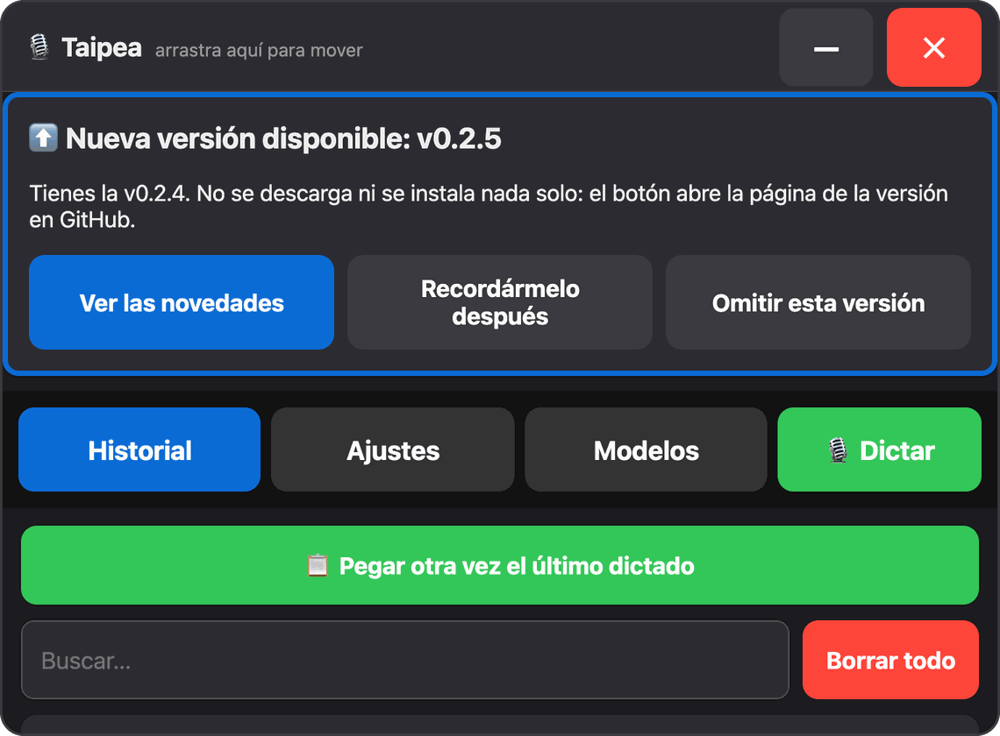

- **Ver las novedades** abre la página de la versión en GitHub. **Recordármelo después**
  oculta el aviso durante 7 días. **Omitir esta versión** lo oculta hasta la siguiente
  versión.
- No se descarga ni se instala nada solo. Para actualizar, vuelve a ejecutar el
  instalador: conserva tus ajustes, tu historial y tus modelos.

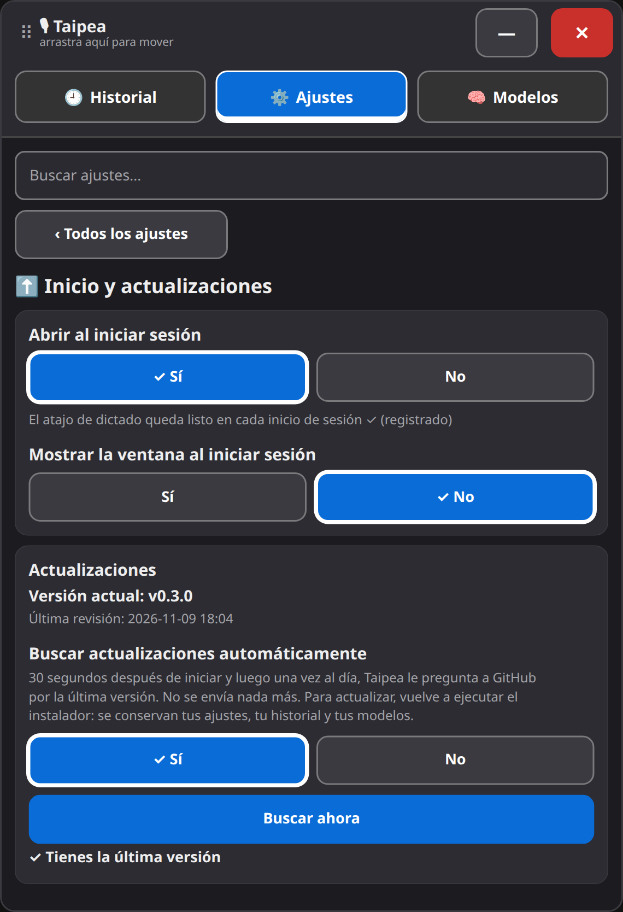

En **Ajustes › Actualizaciones** ves tu versión y la última búsqueda, puedes presionar
**Buscar ahora** o apagar la búsqueda automática. Es la única conexión a internet de Taipea
además de descargar modelos. Mira [Actualizaciones](../README.es.md#actualizaciones) en el
README.

## 9. ¿Problemas?

- [Solución de problemas](../README.es.md#solución-de-problemas): no se pega nada, "No se
  detectó voz", corrección lenta, una ventana fuera de la pantalla, y más.
- [Permisos](../README.es.md#permisos-una-sola-vez)
- ¿Sigues con problemas? [Abre un issue](https://github.com/PatoSelekta/taipea/issues). Los
  reportes de accesibilidad son muy bienvenidos.

*Las capturas usan dictados de ejemplo.*
