# How to use Taipea

[Leer en español](USAGE.es.md) · [Back to the README](../README.md)

This guide shows every part of Taipea with screenshots. Taipea follows your Mac's language,
so on a Mac set to Spanish you will see the same screens in Spanish.

- [1. First launch and permissions](#1-first-launch-and-permissions)
- [2. Dictate: the floating button](#2-dictate-the-floating-button)
- [3. The recording card](#3-the-recording-card)
- [4. Shortcuts](#4-shortcuts)
- [5. The History tab](#5-the-history-tab)
- [6. Settings](#6-settings)
- [7. The Models tab](#7-the-models-tab)
- [8. Updates](#8-updates)
- [9. Problems?](#9-problems)

## 1. First launch and permissions

When the installer finishes, it restarts Hammerspoon. Taipea then shows a 🎙 icon in the
menu bar and a round floating mic button on your screen. To open the Taipea window, press
**Ctrl + Option + H**, open **Taipea.app** from `~/Applications` (you can add it to the
Dock), or choose **Open Taipea…** in the 🎙 menu.

macOS asks for two permissions once. Taipea runs inside Hammerspoon, so both are for
**Hammerspoon**:

1. **Accessibility**, so Taipea can paste where your cursor is. The installer offers to
   open this page for you. Go to System Settings › Privacy & Security › Accessibility and
   turn on **Hammerspoon**.
2. **Microphone**. macOS asks the first time you dictate. Click **Allow**.

If Accessibility is off, the Taipea window shows a red banner with a big **Open
Accessibility settings** button. Your text is not lost: it stays on the clipboard (press
Cmd + V) and in History. If a recording comes back empty, an orange banner points you to
the Microphone settings.

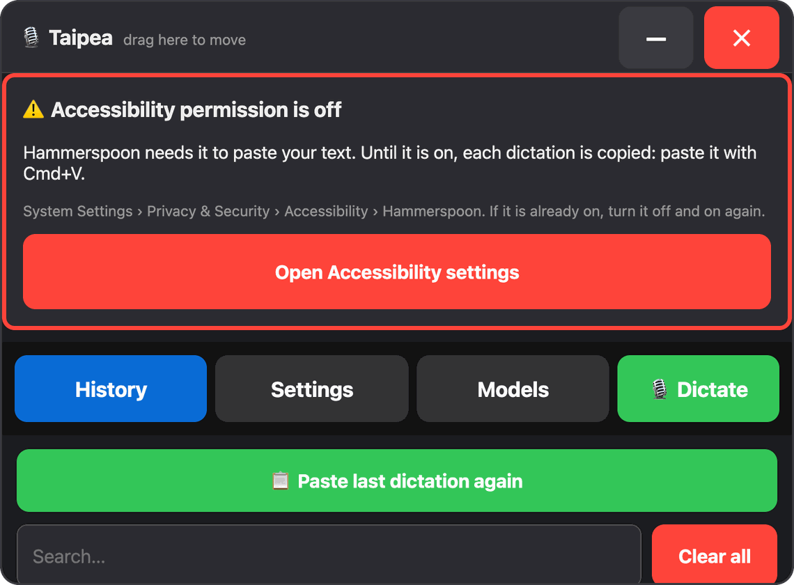

## 2. Dictate: the floating button

The floating button is the easiest way to dictate with a mouse, head mouse or switch. It
stays on top of other windows. Drag it anywhere and it remembers where you left it.

| Idle (Classic Blue) | Idle (Studio) | Recording |
|---|---|---|
|  |  | 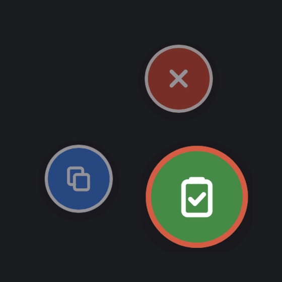 |

- **Idle:** click it to start dictating.
- **Recording:** it turns **green**. Click it to stop: Taipea transcribes, cleans up and
  pastes into the app you were using. Two smaller buttons appear next to it: **blue = Stop
  & Copy only** (the text goes to the clipboard and History, nothing is pasted) and **red
  = Cancel**. They grow and show a label when the pointer is over them.
- **Working:** after you stop, it shows that Taipea is transcribing and cleaning up.
- **Listening:** with voice start / stop on, it gets a green ring while it waits for your
  start phrase.

The colors never change meaning: green = stop and paste, blue = stop and copy only, red =
cancel. Tap **Option + Command** to hide the button, and tap it again to show it (see
[Hide the floating button](#recording-controls-and-hiding-the-floating-button)).

## 3. The recording card

If you turn the floating button off, or turn on **Show the recording card too**, a card
with three big buttons appears while you dictate: **Stop & Paste**, **Stop & Copy only**
and **Cancel**. It shows a timer and how to finish. Drag it wherever you like.

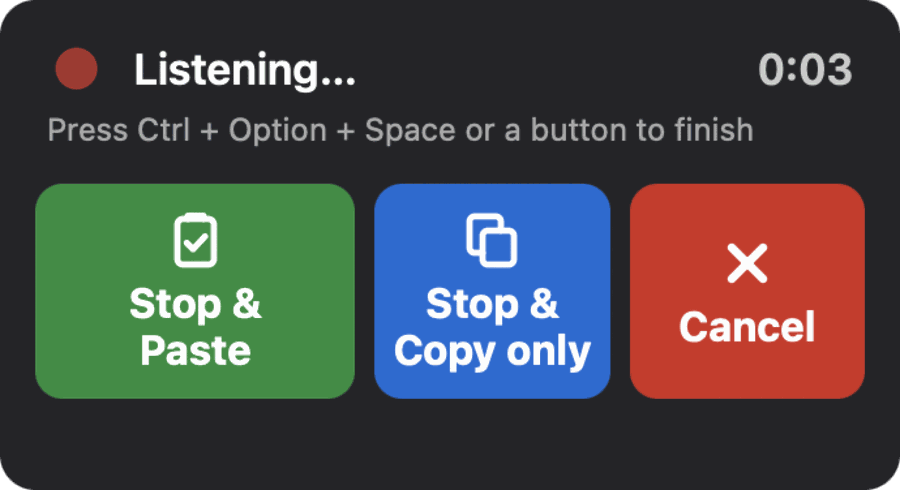

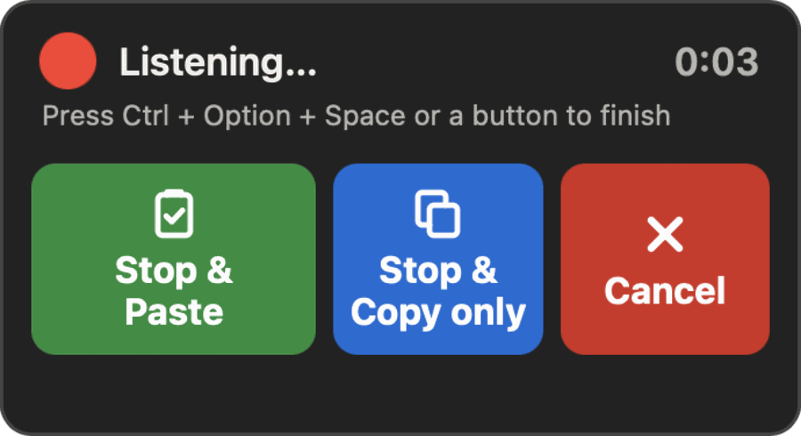

## 4. Shortcuts

| Shortcut | What it does |
|---|---|
| **Ctrl + Option + Space** | Start dictating. Press it again to stop and paste at your cursor. |
| **Ctrl + Option + C** | Turn cleanup on or off. Off = raw text, exactly as Whisper heard it. |
| **Ctrl + Option + H** | Open the Taipea window (History, Settings, Models). |
| **Ctrl + Option + V** | Paste the last dictation again. |
| **Option + Command** (tap) | Hide or show the floating button. Press both keys together and let go. Cmd + Option + other key shortcuts still work. |

You can change the first four in **Settings › Shortcuts**: type a shortcut such as
`ctrl+alt+space` and press **Save**. **Reset shortcuts to defaults** brings these back.
The Option + Command tap is fixed.

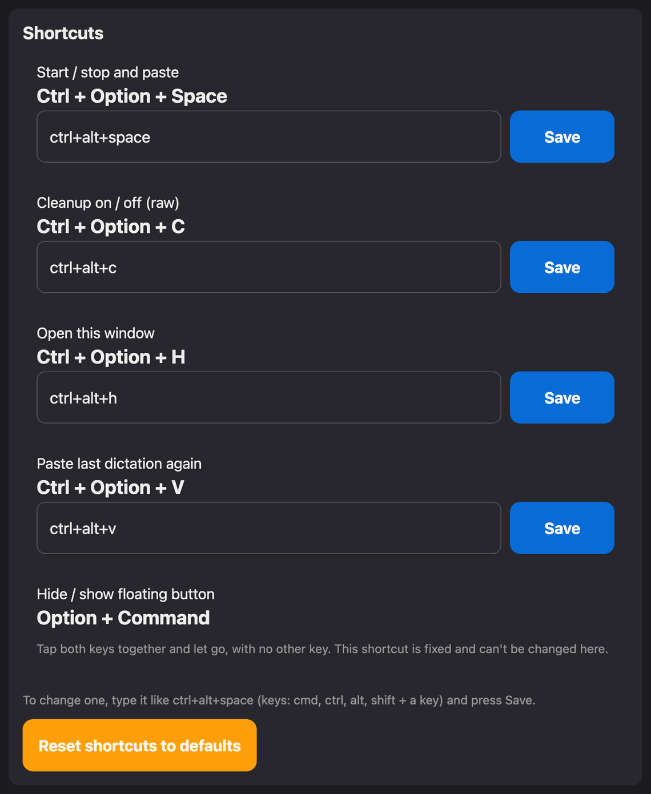

## 5. The History tab

Every dictation is saved on your Mac (`~/Library/Application Support/Taipea/history.json`).

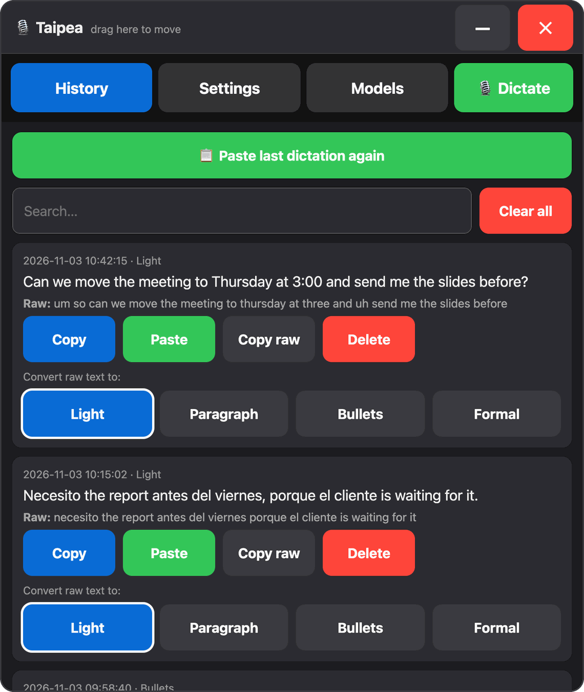

- **📋 Paste last dictation again** at the top (also Ctrl + Option + V).
- **Search** finds words in the cleaned or the raw text.
- For each dictation: **Copy**, **Paste** (into the app you were using), **Copy raw**
  (the words before cleanup) and **Delete**.
- **Convert raw text to:** turns the original words into **Light**, **Paragraph**,
  **Bullets** or **Formal** text with one click. The original words are always kept.
- **Clear all** deletes the whole history. Press it twice: the first press changes it to
  "Tap again to DELETE ALL".

## 6. Settings

Settings are saved right away, with no Save button (except for text boxes). Each card is
described below in the order it appears.

### Language, size, colors, text size and contrast

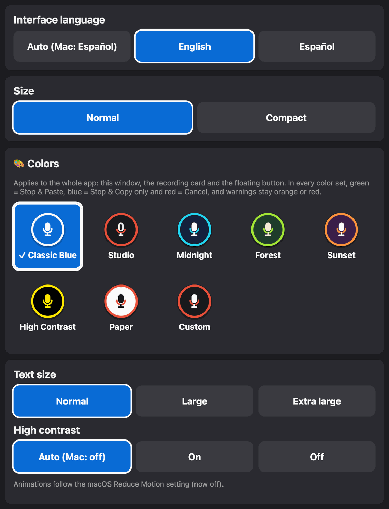

- **Interface language:** Auto (follows your Mac), English or Español.
- **Size:** Normal or Compact (a smaller window).
- **Colors:** 8 sets for the whole app (window, recording card and floating button):
  Classic Blue, Studio, Midnight, Forest, Sunset, High Contrast, Paper and Custom (choose
  the background, mic and accent colors). Text that would be hard to read is fixed
  automatically.
- **Text size:** Normal, Large or Extra large.
- **High contrast:** Auto (follows macOS Increase Contrast), On or Off. Animations follow
  the macOS Reduce Motion setting.

### Auto-stop and voice start / stop

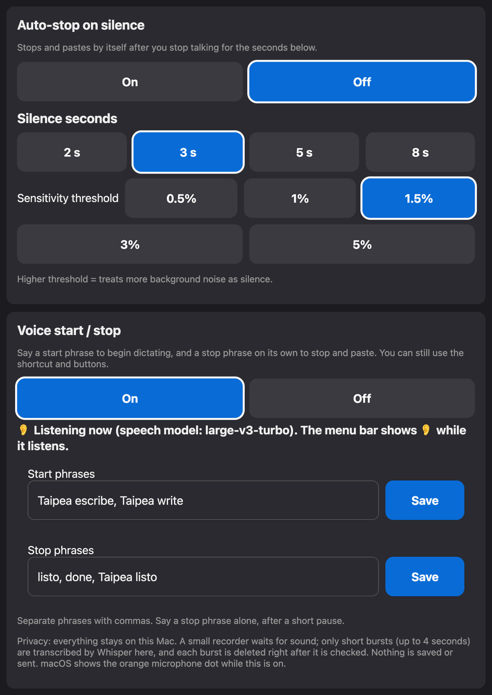

- **Auto-stop on silence:** when On, Taipea stops and pastes by itself after you stop
  talking for 2, 3, 5 or 8 seconds. **Sensitivity threshold:** a higher value treats more
  background noise as silence.
- **Voice start / stop** (off by default): say **"Taipea escribe"** or **"Taipea write"**
  to start, and **"listo"**, **"done"** or **"Taipea listo"** on its own to stop and
  paste. The phrases are editable (separate them with commas). It runs only on your Mac.
  While it listens, the menu bar shows 👂. Read
  [Voice start / stop](../README.md#voice-start--stop) for how it works and its limits.

### Recording controls and hiding the floating button

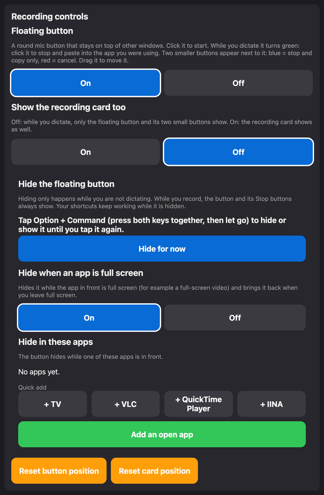

- **Floating button:** On or Off. **Show the recording card too:** also show the big card
  while you dictate.
- **Hide the floating button:** tap **Option + Command** or press **Hide for now**. It
  comes back when you tap again.
- **Hide when an app is full screen** (on by default) and **Hide in these apps** (quick
  buttons for TV, VLC, QuickTime Player and IINA, or **Add an open app**).
- It never hides while you are recording or while Taipea is working, so Stop is always
  reachable.
- **Reset button position** and **Reset card position** bring them back on screen.

### Other settings

- **Custom words:** for example, write "selektdev" when Whisper hears "select dev".
- **Cleanup (grammar fix):** On, or Off (raw). **Style:** Light fix, Paragraphs, Bullet
  points or Formal.
- **Dictation language:** Auto, English or Español.
- **After stopping:** Paste at cursor, or Copy only.
- **Open at login** and **Show window at login**.

## 7. The Models tab

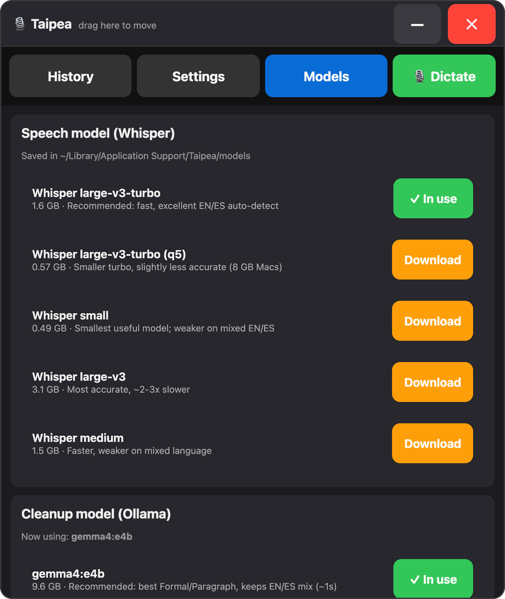

- **Speech model (Whisper)** turns your voice into text. The installer downloads
  large-v3-turbo (or the smaller turbo q5 if you chose it). Press **Download** to get
  another one and **Use** to switch. The one you use shows **✓ In use**. Speech models are
  saved in `~/Library/Application Support/Taipea/models`.
- **Cleanup model (Ollama)** fixes punctuation and grammar. gemma4:e4b is recommended, and
  qwen2.5:7b is the lighter fallback. Taipea uses the fallback automatically if your
  chosen model is not installed.
- **Refresh list** reloads the list, for example after you install a model with Ollama yourself.

## 8. Updates

Once a day Taipea asks GitHub whether there is a newer version. If there is one, the
window shows a banner:

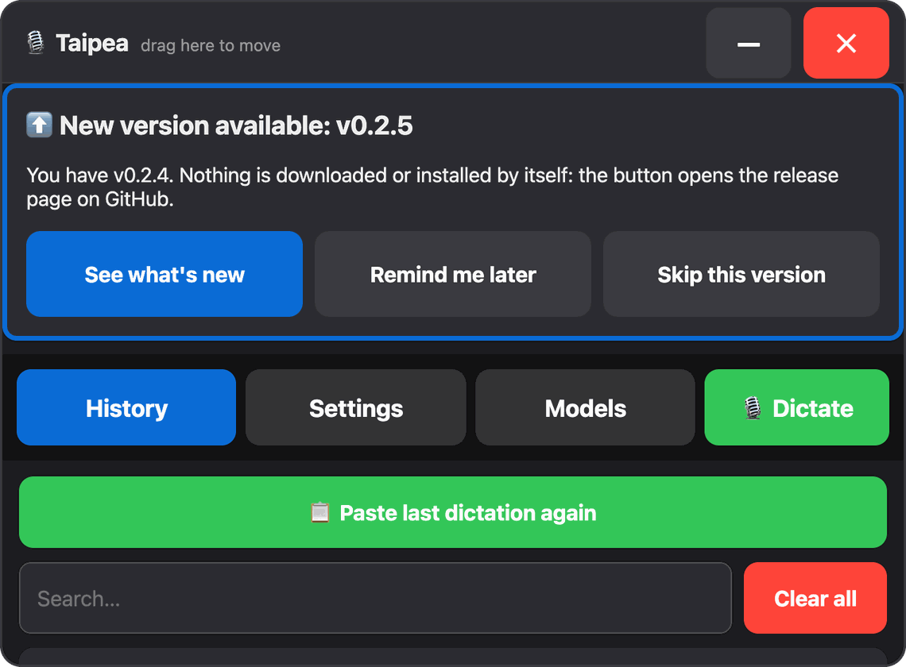

- **See what's new** opens the release page on GitHub. **Remind me later** hides the
  banner for 7 days. **Skip this version** hides it until the next version.
- Nothing is downloaded or installed by itself. To update, run the installer again: it
  keeps your settings, history and models.

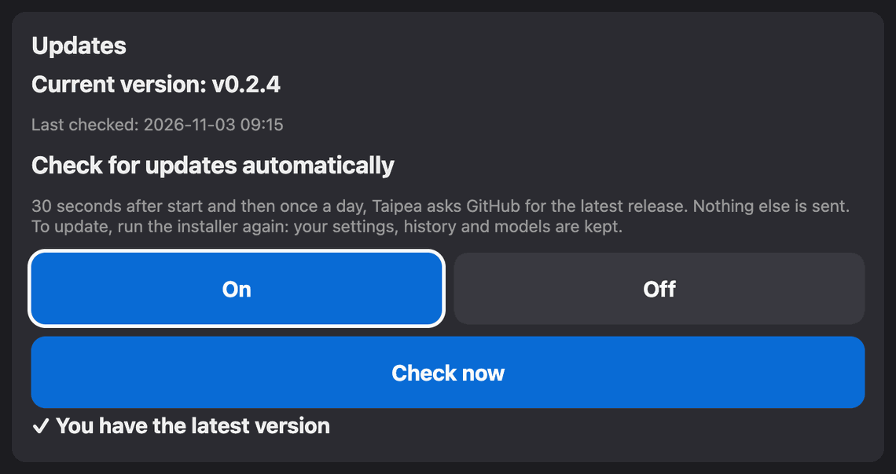

In **Settings › Updates** you can see your version and the last check, press **Check
now**, or turn the automatic check off. This check is Taipea's only network request
besides downloading models. See [Updates](../README.md#updates) in the README.

## 9. Problems?

- [Troubleshooting](../README.md#troubleshooting): nothing is pasted, "No speech detected",
  slow cleanup, a window off screen, and more.
- [Permissions](../README.md#permissions-one-time)
- Still stuck? [Open an issue](https://github.com/PatoSelekta/taipea/issues). Accessibility
  reports are very welcome.

*The screenshots use sample dictations.*
